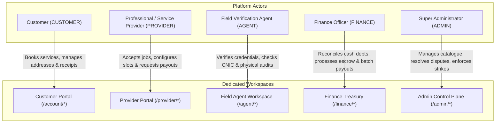
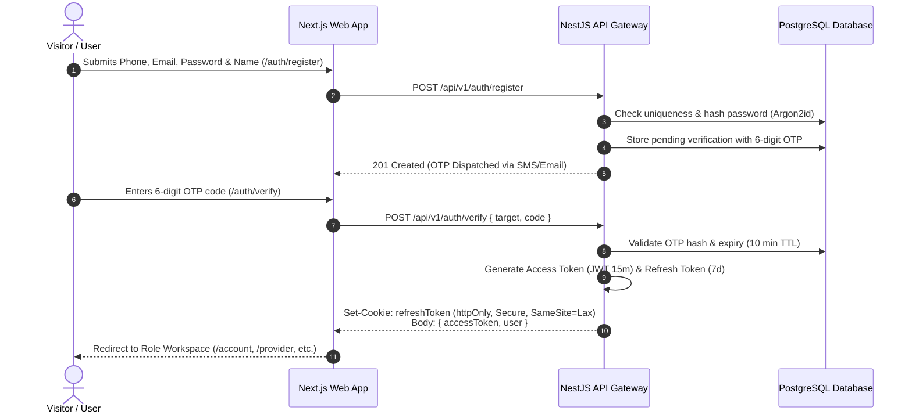
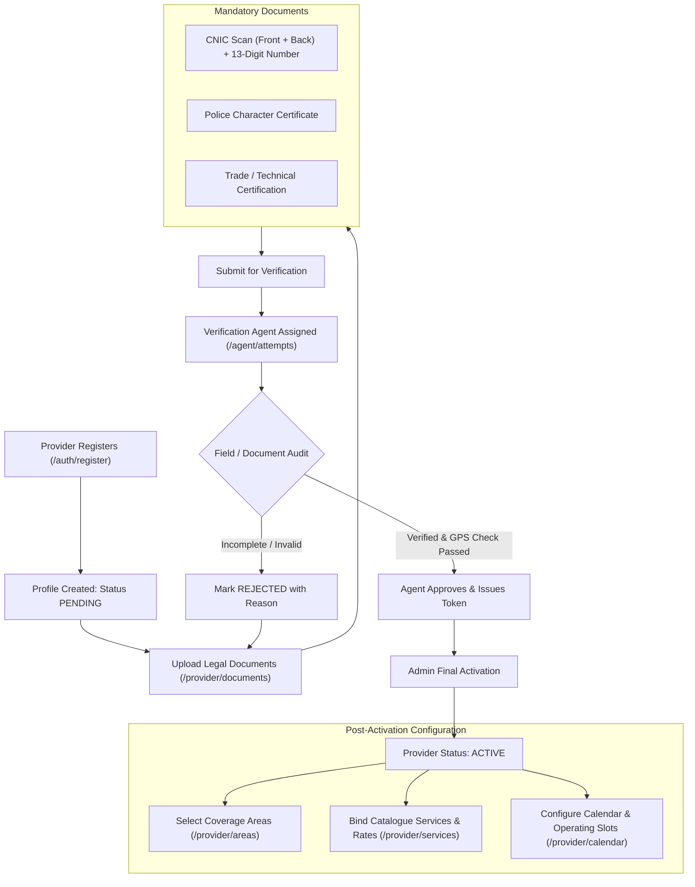
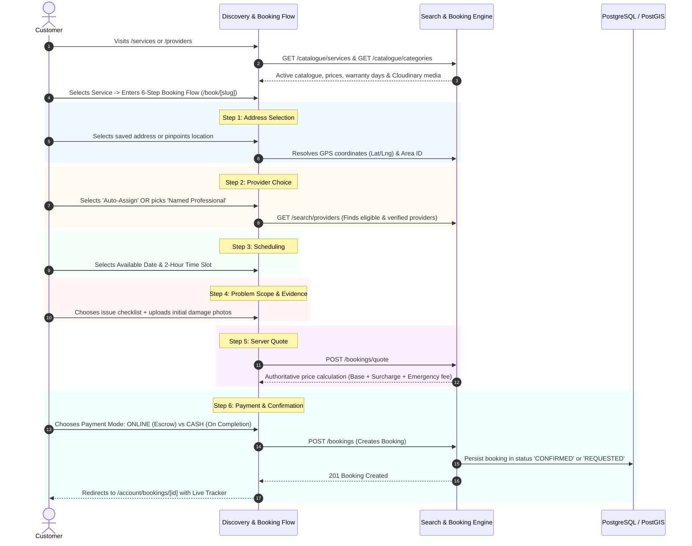
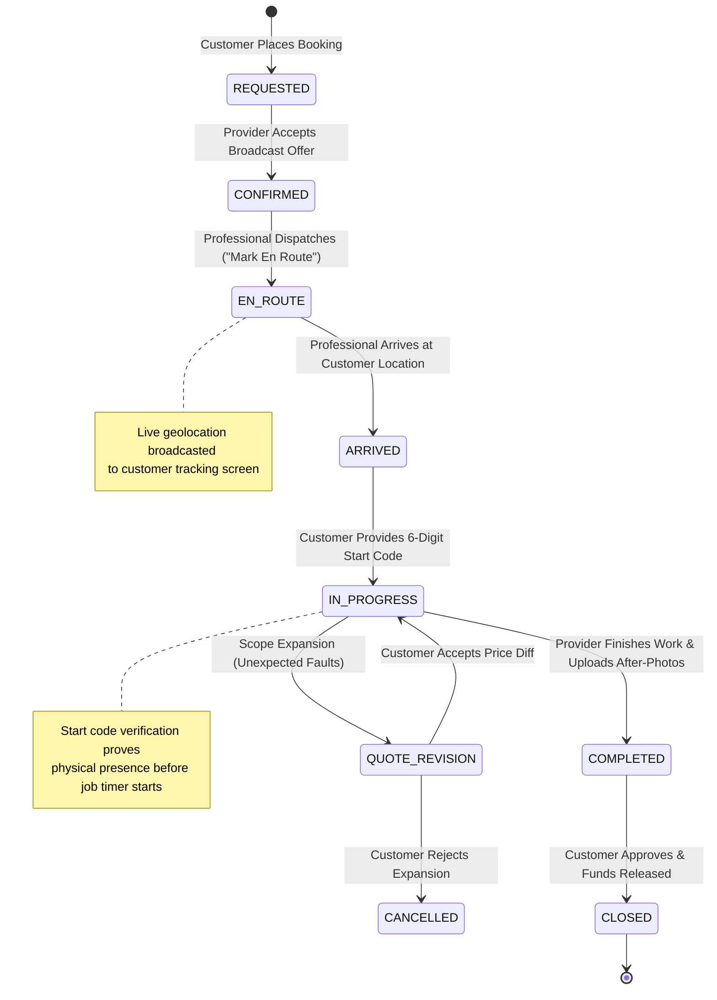
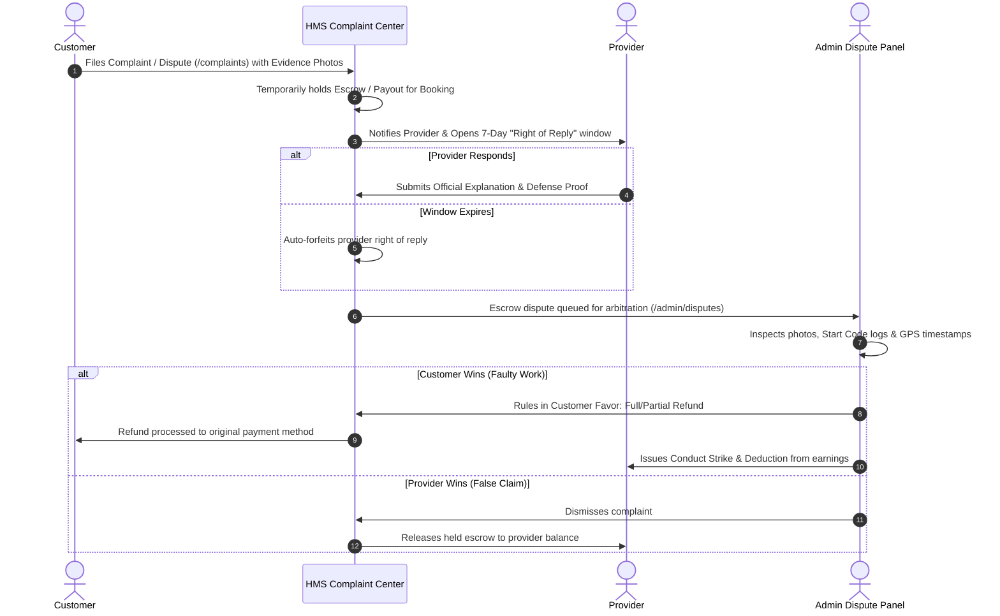
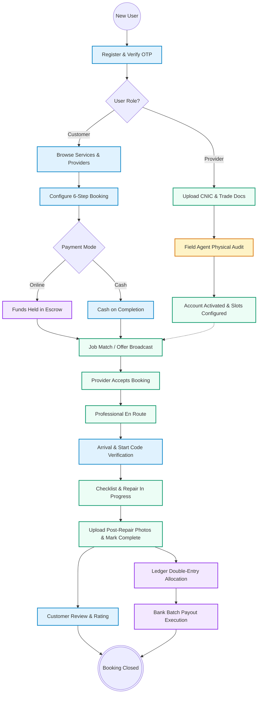

# Smart Home Maintenance Services (HMS) — Complete System Architecture & Workflows

> **Executive Overview**  
> This document details the end-to-end operational, business, and financial workflows of the **Smart Home Maintenance Services (HMS)** platform as implemented in the codebase. It covers user onboarding, provider vetting, booking lifecycle, on-site execution, double-entry financial settlements, and dispute resolution with architectural diagrams.

---

## Table of Contents
1. [Platform Actors & Role Hierarchy](#1-platform-actors--role-hierarchy)
2. [Authentication & Session Architecture](#2-authentication--session-architecture)
3. [Provider Onboarding & Multi-Tier Verification](#3-provider-onboarding--multi-tier-verification)
4. [Customer Service Discovery & 6-Step Booking Flow](#4-customer-service-discovery--6-step-booking-flow)
5. [Field Execution & Job Lifecycle](#5-field-execution--job-lifecycle)
6. [Double-Entry Financial Architecture & Payouts](#6-double-entry-financial-architecture--payouts)
7. [Conduct, Penalties & Dispute Resolution](#7-conduct-penalties--dispute-resolution)
8. [End-to-End System State Machine](#8-end-to-end-system-state-machine)

---

## 1. Platform Actors & Role Hierarchy

HMS enforces strict Role-Based Access Control (RBAC) across five distinct operational roles.



---

## 2. Authentication & Session Architecture

Authentication is secured via password hashing with **Argon2id**, multi-factor **TOTP 2FA**, and **httpOnly SameSite cookies** to prevent XSS and CSRF token extraction.



---

## 3. Provider Onboarding & Multi-Tier Verification

To ensure customer safety and trade excellence, service providers undergo strict background checks before their services can be published.



---

## 4. Customer Service Discovery & 6-Step Booking Flow

Customers can explore trade services with transparent pricing, instant booking guarantees, and an intelligent provider selection model.



---

## 5. Field Execution & Job Lifecycle

The core service execution ensures customer safety via secure **Start Codes**, mandatory before/after **photographic checklists**, and transparent **quote revisions**.



### The On-Site Verification Handshake
1. **En Route State**: Provider updates status to `EN_ROUTE`. Customer sees real-time status and estimated arrival window.
2. **Start Code Verification**: Upon arrival, the customer sees an on-screen **6-Digit Start Code** on `/account/bookings/[id]`. The technician cannot begin the timer or work until this code is entered on `/provider/jobs/[id]`, preventing phantom check-ins.
3. **Pre-Service Checklist & Photos**: The technician photographs the faulty fixture/leak before making modifications.
4. **Post-Service Proof**: After completing the repair, the technician uploads completion photographs and completes the trade checklist.

---

## 6. Double-Entry Financial Architecture & Payouts

All monetary movements inside HMS are governed by double-entry ledger bookkeeping (`packages/domain/ledger`), preventing phantom balances and reconciliation discrepancies.

```mermaid
flowchart TD
    subgraph EscrowManagement["Payment Inflow & Escrow"]
        PAY["Customer Pays (ONLINE or CASH)"]
        PAY -->|ONLINE| ESCROW["Held in Platform Escrow Account"]
        PAY -->|CASH| CASH_RCV["Cash Received Directly by Provider"]
    end

    subgraph JobSettlement["Job Completion Trigger"]
        COMP["Job Marked COMPLETED"]
        ESCROW --> COMP
        CASH_RCV --> COMP
    end

    subgraph LedgerBooking["Double-Entry Ledger Engine"]
        COMP --> LEDGER["Post Ledger Journal Entries"]
        LEDGER -->|Credit| COMM["Platform Commission Revenue (e.g., 15%)"]
        LEDGER -->|Credit| PROV_BAL["Provider Releasable Balance (85%)"]
        LEDGER -->|Debit (If Cash)| DEBT["Provider Platform Debt Created"]
    end

    subgraph PayoutWorkflow["Provider Payout & Reconciliation"]
        PROV_BAL --> REQ["Provider Requests Payout (/provider/payouts)"]
        REQ --> BATCH["Finance Aggregates Weekly Batch (/finance/payout-batches)"]
        DEBT -->|Deducted from Batch| BATCH
        BATCH --> BANK["Dispatched to Provider Bank / 1Link IBAN"]
    end
```

### Financial Rules & Balances
- **Online Bookings**: Funds are captured into platform escrow. Upon completion, net earnings are automatically moved into `Releasable Balance`.
- **Cash Bookings**: The customer pays the full amount in cash to the provider. The platform logs a `Cash Debt` for the platform commission. This debt is offset against the provider’s future online earnings or cleared via direct payment.
- **Batched Payouts**: The Finance department reviews aggregated payout batches, verifying compliance and deduction rules before executing wire transfers.

---

## 7. Conduct, Penalties & Dispute Resolution

To protect platform integrity, customer complaints and provider conduct are strictly monitored through an algorithmic penalty and strike system.



### Strike & Penalty Rules
- **No-Show / Late Cancellation**: Provider incurs immediate strike points.
- **Safety Violation**: Instant suspension pending review by the operations team.
- **Threshold Block**: Reaching threshold points automatically prevents the provider from appearing in discovery or receiving broadcast job offers.

---

## 8. End-to-End System State Machine

The unified lifecycle diagram illustrating how data transitions across Customer, Provider, Agent, and Finance roles:



---

## 9. Key API Endpoints & Route Mapping

| Workflow Stage | Frontend Route | Backend REST Endpoint | Primary Contract / DTO |
| :--- | :--- | :--- | :--- |
| **Authentication** | `/auth/sign-in`, `/auth/register` | `POST /api/v1/auth/login`, `POST /api/v1/auth/verify` | `LoginSchema`, `OtpVerifySchema` |
| **Provider Vetting** | `/provider/documents` | `POST /api/v1/provider/documents` | `DocumentUploadDto` |
| **Agent Verification** | `/agent/attempts`, `/verification/[token]`| `POST /api/v1/agent/attempts` | `VerificationAttemptDto` |
| **Catalogue & Search**| `/services`, `/providers` | `GET /api/v1/catalogue/services`, `GET /api/v1/search/providers` | `ProviderSearchQueryDto` |
| **Booking Flow** | `/book/[slug]` | `POST /api/v1/bookings/quote`, `POST /api/v1/bookings` | `BookingQuoteInput`, `CreateBookingDto` |
| **Job Execution** | `/provider/today`, `/provider/jobs/[id]` | `PATCH /api/v1/provider/bookings/:id/status`, `POST /api/v1/provider/bookings/:id/start-code` | `StartCodeVerificationDto` |
| **Customer Tracking** | `/track`, `/account/bookings/[id]` | `GET /api/v1/bookings/:id`, `GET /api/v1/bookings/:id/tracker` | `BookingDetailDto` |
| **Finance & Ledger** | `/finance/payout-batches`, `/finance/ledger` | `POST /api/v1/finance/payout-batches`, `GET /api/v1/finance/ledger` | `CreatePayoutBatchDto` |
| **Disputes & Conduct**| `/admin/disputes`, `/provider/conduct` | `POST /api/v1/complaints`, `PATCH /api/v1/admin/disputes/:id/resolve` | `DisputeResolutionDto` |

---

*Document generated and verified against the live HMS repository schemas, Prisma migrations, NestJS controllers, and Next.js Turbopack client applications.*
