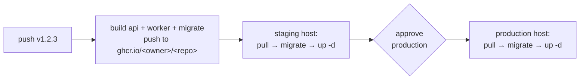

# Runbook: build and deploy

**Workflow:** `.github/workflows/deploy.yml` · **Ticket:** SHM-094 · **Images:** `infra/../Dockerfile`

A release builds three images — `api`, `worker`, `migrate` — from one multi-stage `Dockerfile`,
pushes them to GHCR, then rolls the staging host and, after a human approves, production. The
acceptance criterion is "staging deploy from a tag with zero manual steps": pushing a `v*.*.*` tag
is the entire trigger.

## What a release does



- **`migrate` runs before `up -d`** on each host, from that host's own `migrate` image. Database
  credentials never leave the host, and the schema is always the one matching the images.
- **Production is gated by an environment reviewer** (GitHub → Settings → Environments →
  `production` → Required reviewers). That review *is* the manual approval.
- Both hosts are rolled the same way, so staging is a real rehearsal of production.

## First-time setup (once per host)

1. Install Docker Engine + the Compose plugin.
2. Create the deploy directory (default `/srv/smart-home`, override with the `STAGING_DEPLOY_PATH`
   / `PRODUCTION_DEPLOY_PATH` repository variables) and give the deploy user ownership.
3. Put the repository's `infra/` and `ops/` directories there, and write `.env` from
   `.env.production.example` with fresh secrets. Every `${VAR:?}` in
   `infra/docker-compose.prod.yml` must be present or the stack refuses to start.
4. Configure the repository secrets the workflow reads:

   | Secret | Purpose |
   |---|---|
   | `STAGING_SSH_KEY` / `PRODUCTION_SSH_KEY` | private key the runner uses to ssh in |
   | `STAGING_HOST` / `PRODUCTION_HOST` | hostname or IP |
   | `STAGING_USER` / `PRODUCTION_USER` | deploy user (member of the `docker` group) |
   | `STAGING_SSH_KNOWN_HOSTS` / `PRODUCTION_SSH_KNOWN_HOSTS` | pinned host keys (`ssh-keyscan <host>`) |

   No registry secret is needed: `GITHUB_TOKEN` pushes the images and the same token is piped to
   the host's `docker login` over ssh stdin for the pull.

## Verify a deployment

```bash
# On the host:
docker compose -f infra/docker-compose.prod.yml --env-file .env ps
curl -fsS http://localhost:3000/health/ready | jq   # status and every dependency
curl -fsS http://localhost:3000/metrics | grep '^shm_' | head
curl -fsS http://localhost:9464/metrics | grep '^shm_jobs_total'   # the worker's own registry
```

`docker compose ps` should show `postgis`, `redis`, `api`, `worker`, `prometheus` as `healthy`.
`/health/ready` answers `503` (not a `200` with a `"down"` body) when a dependency is unreachable.

## Rollback

Images are immutable and tagged by version, so a rollback is a re-deploy of the previous tag:

```bash
# On the host:
IMAGE_TAG=v1.2.2 docker compose -f infra/docker-compose.prod.yml --env-file .env pull
IMAGE_TAG=v1.2.2 docker compose -f infra/docker-compose.prod.yml --env-file .env up -d --remove-orphans
```

Migrations are **not** rolled back automatically — dbmate migrations are forward-only. If a release
included a destructive migration, restore from the most recent dump instead; see
[restore-drill.md](./restore-drill.md). This is why migrations should be additive and reversible by
the next release, not by `down`.

## When it goes wrong

- **A host rolled but the container is unhealthy.** `docker compose logs --tail 200 api`. A boot
  failure is almost always the environment schema refusing a value — the log names the variable and
  the expectation (see [api-down.md](./api-down.md)).
- **`docker login` fails on the host.** The `GITHUB_TOKEN` is scoped to the run; a manual roll must
  log in with a PAT that has `read:packages`.
- **Migrations fail.** The `migrate` service logs the dbmate error. `DIRECT_URL` must reach Postgres
  with the `postgres` superuser or a role that can create the `schema_migrations` table. Do not roll
  `up -d` on top of a half-applied migration; fix and re-run `migrate`.
- **The stack starts but the app exits on an env error.** Compare `.env` against
  `.env.production.example`; production refuses development secrets, the dev inbox, and any
  non-`mock` provider.

## Escalate when

Do not debug a bad deploy alone. Escalate to the backend on-call, with the deploy run's URL and the
container logs attached, as soon as **any** of these is true:

- `api` or `worker` is not `healthy` within **2 minutes** of `up -d` (boot loop, not slow start).
- `curl -fsS http://localhost:3000/health/ready` returns **503** after the containers are up.
- `migrate` exited non-zero — the schema is now half-applied; **stop rolling**, do not retry blindly.
- A rollback to the previous tag also leaves `/health/ready` at 503 (the migration, not the image, is
  the suspect — restore from the latest dump, see [restore-drill.md](./restore-drill.md)).
- Customer-facing errors: any 5xx rate above **1%** on the API, or the worker failing its repeatable
  jobs (watch `shm_jobs_total{outcome="failed"}` and `shm_queue_depth`).

Quick triage before you escalate:

```bash
docker compose -f infra/docker-compose.prod.yml --env-file .env ps
docker compose -f infra/docker-compose.prod.yml --env-file .env logs --tail 200 api worker migrate
curl -fsS http://localhost:3000/health/ready | jq
```

## Known gaps

- Object storage and SMTP are still the in-process mocks (SHM-011); there is deliberately no MinIO
  or Mailpit in the production compose until a real adapter exists (OQ-03/OQ-04).
- Alert delivery (Alertmanager routing) is not configured here — Prometheus loads the rules from
  `ops/prometheus/alerts.yml`, but where a firing alert is sent is an open ops decision.
